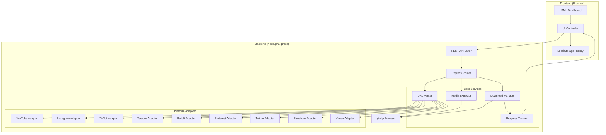
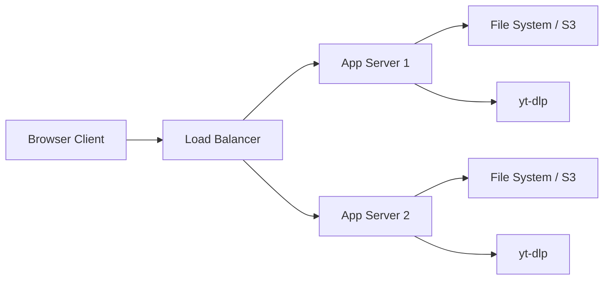

# Design Document: Multi-Platform Downloader

## Overview

The Multi-Platform Downloader is a full-stack web application that enables users to download video and audio content from nine major platforms (YouTube, Instagram, TikTok, Terabox, Reddit, Pinterest, Twitter, Facebook, Vimeo). The system consists of a Node.js/Express backend that integrates with yt-dlp for media extraction, a RESTful API for client-server communication, and frontend JavaScript that wires the existing cyberpunk-themed HTML dashboard to real backend services.

The architecture follows a platform adapter pattern for extensibility, uses Server-Sent Events (SSE) for real-time progress tracking, and leverages browser localStorage for download history persistence. The design prioritizes modularity, allowing new platforms to be added without modifying core logic, and maintains the existing UI aesthetic while adding full functionality.

### Key Design Goals

1. **Modularity**: Platform-specific logic isolated in adapters
2. **Real-time feedback**: SSE-based progress streaming
3. **Extensibility**: Easy addition of new platforms
4. **UI preservation**: Wire existing HTML without visual changes
5. **Performance**: Concurrent downloads with resource management
6. **Reliability**: Comprehensive error handling and retry logic

## Architecture

### System Architecture Diagram



### Technology Stack

**Backend:**
- Runtime: Node.js 18+
- Framework: Express 4.x
- Media extraction: yt-dlp (Python CLI tool)
- Process management: child_process (Node.js built-in)
- Real-time communication: Server-Sent Events (SSE)

**Frontend:**
- Vanilla JavaScript (ES6+)
- Fetch API for HTTP requests
- EventSource API for SSE
- LocalStorage API for persistence

**Development:**
- TypeScript (optional, for type safety)
- ESLint for code quality
- Jest for unit testing
- Supertest for API testing

### Deployment Architecture



## Components and Interfaces

### 1. URL Parser Component

**Responsibility**: Validate URLs and identify platform/video ID

**Interface:**
```typescript
interface URLParser {
  parse(url: string): ParseResult;
  isSupported(url: string): boolean;
  getPlatform(url: string): Platform;
}

interface ParseResult {
  isValid: boolean;
  platform: Platform | null;
  videoId: string | null;
  error?: string;
}

enum Platform {
  YOUTUBE = 'youtube',
  INSTAGRAM = 'instagram',
  TIKTOK = 'tiktok',
  TERABOX = 'terabox',
  REDDIT = 'reddit',
  PINTEREST = 'pinterest',
  TWITTER = 'twitter',
  FACEBOOK = 'facebook',
  VIMEO = 'vimeo'
}
```

**Implementation Strategy:**
- Use regex patterns for each platform
- Validate URL structure before platform detection
- Return standardized ParseResult for all platforms
- Cache regex compilation for performance

### 2. Platform Adapter Interface

**Responsibility**: Provide standardized interface for platform-specific extraction

**Interface:**
```typescript
interface PlatformAdapter {
  name: Platform;
  urlPattern: RegExp;
  extractVideoId(url: string): string | null;
  getYtDlpArgs(url: string, options: ExtractOptions): string[];
  parseMetadata(rawData: any): MediaMetadata;
}

interface ExtractOptions {
  audioOnly?: boolean;
  quality?: string;
  format?: string;
}

interface MediaMetadata {
  title: string;
  thumbnail: string;
  duration: number;
  formats: MediaFormat[];
  author?: string;
  uploadDate?: string;
}

interface MediaFormat {
  formatId: string;
  resolution: string;
  codec: string;
  container: string;
  filesize: number;
  fps?: number;
  vcodec?: string;
  acodec?: string;
}
```

**Adapter Registry:**
```typescript
class AdapterRegistry {
  private adapters: Map<Platform, PlatformAdapter>;
  
  register(adapter: PlatformAdapter): void;
  getAdapter(platform: Platform): PlatformAdapter;
  getAdapterForUrl(url: string): PlatformAdapter | null;
}
```

### 3. Media Extractor Component

**Responsibility**: Fetch available formats from source platforms

**Interface:**
```typescript
interface MediaExtractor {
  analyze(url: string): Promise<AnalysisResult>;
  getFormats(url: string): Promise<MediaFormat[]>;
}

interface AnalysisResult {
  success: boolean;
  metadata: MediaMetadata;
  availableQualities: QualityOption[];
  error?: ExtractorError;
}

interface QualityOption {
  label: string;
  resolution: string;
  formatId: string;
  codec: string;
  container: string;
  filesize: number;
}

interface ExtractorError {
  code: ErrorCode;
  message: string;
  retryable: boolean;
}

enum ErrorCode {
  NETWORK_ERROR = 'NETWORK_ERROR',
  ACCESS_DENIED = 'ACCESS_DENIED',
  PLATFORM_UNAVAILABLE = 'PLATFORM_UNAVAILABLE',
  VIDEO_NOT_FOUND = 'VIDEO_NOT_FOUND',
  INVALID_URL = 'INVALID_URL'
}
```

**Implementation:**
- Spawn yt-dlp process with `--dump-json` flag
- Parse JSON output to extract metadata
- Map yt-dlp formats to standardized QualityOption
- Implement timeout (5 seconds) for analysis
- Cache analysis results for 5 minutes

### 4. Download Manager Component

**Responsibility**: Handle file download operations and progress tracking

**Interface:**
```typescript
interface DownloadManager {
  startDownload(request: DownloadRequest): Promise<DownloadSession>;
  cancelDownload(sessionId: string): Promise<void>;
  getProgress(sessionId: string): DownloadProgress | null;
}

interface DownloadRequest {
  url: string;
  formatId: string;
  audioOnly: boolean;
  outputPath?: string;
}

interface DownloadSession {
  sessionId: string;
  status: DownloadStatus;
  progressStream: ReadableStream<DownloadProgress>;
}

interface DownloadProgress {
  sessionId: string;
  status: DownloadStatus;
  percent: number;
  downloadedBytes: number;
  totalBytes: number;
  speed: number;
  eta: number;
  filename: string;
}

enum DownloadStatus {
  QUEUED = 'QUEUED',
  DOWNLOADING = 'DOWNLOADING',
  PROCESSING = 'PROCESSING',
  COMPLETED = 'COMPLETED',
  FAILED = 'FAILED',
  CANCELLED = 'CANCELLED'
}
```

**Implementation:**
- Spawn yt-dlp process with selected format
- Parse stdout for progress updates
- Emit progress events via SSE
- Limit concurrent downloads to 3
- Queue additional requests
- Clean up completed sessions after 1 hour

### 5. Progress Tracker Component

**Responsibility**: Monitor and report download progress in real-time

**Interface:**
```typescript
interface ProgressTracker {
  trackSession(sessionId: string, process: ChildProcess): void;
  getProgress(sessionId: string): DownloadProgress | null;
  subscribe(sessionId: string, callback: ProgressCallback): Unsubscribe;
}

type ProgressCallback = (progress: DownloadProgress) => void;
type Unsubscribe = () => void;
```

**Implementation:**
- Parse yt-dlp stdout for progress lines
- Extract percent, speed, ETA from output
- Maintain in-memory progress state
- Support multiple subscribers per session
- Clean up completed sessions

### 6. REST API Layer

**Endpoints:**

```typescript
// POST /api/analyze
interface AnalyzeRequest {
  url: string;
}

interface AnalyzeResponse {
  success: boolean;
  data?: AnalysisResult;
  error?: ApiError;
}

// POST /api/download
interface DownloadRequestBody {
  url: string;
  formatId: string;
  audioOnly: boolean;
}

interface DownloadResponse {
  success: boolean;
  sessionId?: string;
  error?: ApiError;
}

// GET /api/progress/:sessionId (SSE)
// Returns: text/event-stream
// Events: progress, complete, error

// GET /api/history
interface HistoryResponse {
  success: boolean;
  records: DownloadRecord[];
}

interface DownloadRecord {
  id: string;
  filename: string;
  filesize: number;
  timestamp: number;
  thumbnail: string;
  platform: Platform;
  status: DownloadStatus;
  error?: string;
}

interface ApiError {
  code: string;
  message: string;
  details?: any;
}
```

### 7. UI Controller Component

**Responsibility**: Wire existing HTML elements to backend functionality

**Interface:**
```typescript
class UIController {
  private apiClient: ApiClient;
  private historyStore: HistoryStore;
  
  initialize(): void;
  handleExtractClick(): Promise<void>;
  handleDownloadClick(): Promise<void>;
  handleQualitySelect(formatId: string): void;
  handleAudioToggle(enabled: boolean): void;
  updateStatus(status: string): void;
  updateProgress(progress: DownloadProgress): void;
  displayError(error: ApiError): void;
  refreshHistory(): void;
}
```

**DOM Element Mapping:**
- Input field: `input[type="text"]` (URL input)
- Extract button: Button with text "EXTRACT"
- Download button: Button with text "Initialize Download"
- Status display: Elements showing "Status", "Traffic", etc.
- Quality buttons: Grid of quality selection buttons
- Audio toggle: Toggle switch element
- History cards: "Recent Transfers" section cards

### 8. History Store Component

**Responsibility**: Persist download records in browser localStorage

**Interface:**
```typescript
interface HistoryStore {
  addRecord(record: DownloadRecord): void;
  getRecords(limit?: number): DownloadRecord[];
  clearHistory(): void;
}
```

**Implementation:**
- Store records as JSON in localStorage key `kinetic_dl_history`
- Maintain maximum 100 records
- Remove oldest when limit exceeded
- Provide migration for schema changes

## Data Models

### Download Record Schema

```typescript
interface DownloadRecord {
  id: string;                 // UUID v4
  url: string;                // Original URL
  filename: string;           // Sanitized filename
  filesize: number;           // Bytes
  timestamp: number;          // Unix timestamp (ms)
  thumbnail: string;          // URL or base64
  platform: Platform;         // Platform enum
  status: DownloadStatus;     // Status enum
  quality: string;            // e.g., "1080P_HD"
  audioOnly: boolean;         // Audio extraction flag
  error?: string;             // Error message if failed
  duration?: number;          // Video duration (seconds)
  author?: string;            // Content creator
}
```

### Session State Schema

```typescript
interface SessionState {
  sessionId: string;
  url: string;
  formatId: string;
  audioOnly: boolean;
  status: DownloadStatus;
  progress: DownloadProgress;
  startTime: number;
  endTime?: number;
  error?: ExtractorError;
  process?: ChildProcess;
}
```

## Correctness Properties

*A property is a characteristic or behavior that should hold true across all valid executions of a system—essentially, a formal statement about what the system should do. Properties serve as the bridge between human-readable specifications and machine-verifiable correctness guarantees.*

Before defining properties, I need to analyze the acceptance criteria to determine which are testable as properties.


### Property Reflection

After analyzing all acceptance criteria, I've identified several areas of redundancy:

1. **URL Parsing Properties (1.1, 1.2, 1.3)**: These can be combined into a comprehensive URL parsing property that covers validation, extraction, and error handling.

2. **UI State Update Properties (1.5, 5.2, 5.3, 5.5)**: Multiple properties test UI state updates for different events. These can be consolidated into properties about state transitions.

3. **Format Display Properties (2.4, 2.5, 3.3)**: These all test UI rendering of format data and can be combined.

4. **Progress Display Properties (6.2, 6.3, 6.4)**: These test different aspects of progress display formatting and can be unified.

5. **History Record Properties (8.1, 8.5, 9.3)**: These test record structure and can be combined into a single property about record completeness.

6. **Status Badge Properties (9.4, 9.5)**: These test badge rendering for different statuses and can be unified.

7. **Error Message Properties (11.1-11.4)**: These test specific error messages but the underlying property is the same - error mapping.

8. **API Response Properties (12.5, 12.6)**: These test response format and can be combined.

After reflection, I've identified the following unique, non-redundant properties:

### Property 1: URL Parsing Correctness
*For any* URL string, the URL_Parser SHALL return a ParseResult with isValid=true if and only if the URL matches a supported platform pattern, and when valid, SHALL correctly extract the platform identifier and video ID.

**Validates: Requirements 1.1, 1.2, 1.3**

### Property 2: Platform URL Recognition
*For any* registered PlatformAdapter, the URL_Parser SHALL recognize URLs matching that adapter's pattern and route them to the correct adapter.

**Validates: Requirements 10.3, 10.5**

### Property 3: Format Extraction Completeness
*For any* yt-dlp JSON output containing format data, the Media_Extractor SHALL parse and return all available video resolutions and audio formats without loss of information.

**Validates: Requirements 2.2, 2.3**

### Property 4: Quality Selection Default
*For any* non-empty list of available formats, the Quality_Selector SHALL select the format with the highest resolution as the default selection.

**Validates: Requirements 3.1**

### Property 5: UI State Consistency
*For any* application state transition (IDLE → ANALYZING → DOWNLOADING → COMPLETED), the UI_Controller SHALL update all status displays to reflect the current state without skipping intermediate states.

**Validates: Requirements 1.5, 5.2, 5.3, 13.3**

### Property 6: Audio Extraction Parameters
*For any* download request with audioOnly=true, the Download_Manager SHALL configure yt-dlp with audio extraction parameters matching the selected format (MP3 at 320kbps or FLAC lossless).

**Validates: Requirements 4.3, 4.4**

### Property 7: Filename Sanitization
*For any* video title string (including special characters, unicode, path separators), the Download_Manager SHALL produce a sanitized filename that is valid on all major filesystems (Windows, macOS, Linux).

**Validates: Requirements 7.2**

### Property 8: Download Progress Monotonicity
*For any* download session, the Progress_Tracker SHALL report progress percentages that are monotonically non-decreasing (each update >= previous update) until completion at 100%.

**Validates: Requirements 6.6**

### Property 9: Progress Display Formatting
*For any* DownloadProgress update, the UI_Controller SHALL format and display speed (MB/s or GB/s), sizes (downloaded/total), and ETA in human-readable format with appropriate unit scaling.

**Validates: Requirements 6.2, 6.3, 6.4**

### Property 10: History Record Completeness
*For any* completed or failed download, the History_Store SHALL create a DownloadRecord containing all required fields (id, filename, filesize, timestamp, thumbnail, platform, status) with no null values except optional fields.

**Validates: Requirements 8.1, 8.5, 9.3**

### Property 11: History Size Limit Enforcement
*For any* sequence of history additions, the History_Store SHALL maintain exactly min(total_additions, 100) records, removing the oldest record when the 101st record is added.

**Validates: Requirements 8.3, 8.4**

### Property 12: History Display Ordering
*For any* history state with N records (N >= 3), the UI_Controller SHALL display the 3 most recent records in descending chronological order (newest first).

**Validates: Requirements 9.1, 9.2**

### Property 13: Status Badge Color Mapping
*For any* DownloadRecord, the UI_Controller SHALL render a status badge with color matching the status: green (#8eff71) for COMPLETED, red (#ff7073) for ERROR/FAILED, and yellow/neutral for other states.

**Validates: Requirements 9.4, 9.5, 13.7**

### Property 14: Error Code Mapping
*For any* extraction or download error, the system SHALL map the underlying error to one of the defined ErrorCode values (NETWORK_ERROR, ACCESS_DENIED, PLATFORM_UNAVAILABLE, VIDEO_NOT_FOUND, INVALID_URL) with an appropriate user-facing message.

**Validates: Requirements 11.1, 11.2, 11.3, 11.4**

### Property 15: Concurrent Download Limit
*For any* number of download requests N, the Download_Manager SHALL execute at most 3 downloads concurrently, queueing additional requests until a slot becomes available.

**Validates: Requirements 14.3**

### Property 16: API Response Structure
*For any* API endpoint response (success or error), the Backend_API SHALL return valid JSON with appropriate HTTP status code (2xx for success, 4xx for client errors, 5xx for server errors) and include required fields for that endpoint.

**Validates: Requirements 12.5, 12.6**

### Property 17: Adapter Interface Conformance
*For any* PlatformAdapter implementation, the adapter SHALL implement all required interface methods (extractVideoId, getYtDlpArgs, parseMetadata) and return data structures conforming to the defined interfaces.

**Validates: Requirements 10.1, 10.5**

### Property 18: Quality Button State Consistency
*For any* set of available formats, the Quality_Selector SHALL enable buttons for available resolutions and disable buttons for unavailable resolutions, with exactly one button in selected state at any time (unless audio-only mode is active).

**Validates: Requirements 2.5, 3.2, 3.4**

### Property 19: Download Validation
*For any* download initiation attempt, the UI_Controller SHALL prevent the download if no quality is selected, displaying a validation error message.

**Validates: Requirements 5.4**

### Property 20: Metadata Preservation
*For any* audio extraction with source metadata (title, artist, thumbnail), the Audio_Converter SHALL embed the metadata in the output file and the Download_Manager SHALL include it in the DownloadRecord.

**Validates: Requirements 4.5**

## Error Handling

### Error Categories

1. **Network Errors**
   - Connection timeout
   - DNS resolution failure
   - Connection refused
   - SSL/TLS errors

2. **Platform Errors**
   - Video not found (404)
   - Access denied (403)
   - Rate limiting (429)
   - Platform API changes

3. **Extraction Errors**
   - Unsupported format
   - DRM-protected content
   - Geo-restricted content
   - Age-restricted content

4. **Download Errors**
   - Disk space insufficient
   - Write permission denied
   - Download interrupted
   - Corrupted download

5. **Validation Errors**
   - Invalid URL format
   - Unsupported platform
   - Missing required parameters
   - Invalid format selection

### Error Handling Strategy

```typescript
class ErrorHandler {
  handleError(error: Error, context: ErrorContext): ErrorResponse {
    const errorCode = this.classifyError(error);
    const retryable = this.isRetryable(errorCode);
    const userMessage = this.getUserMessage(errorCode);
    
    // Log error for debugging
    logger.error({
      code: errorCode,
      message: error.message,
      stack: error.stack,
      context
    });
    
    return {
      code: errorCode,
      message: userMessage,
      retryable,
      details: process.env.NODE_ENV === 'development' ? error.stack : undefined
    };
  }
  
  private classifyError(error: Error): ErrorCode {
    // Network errors
    if (error.message.includes('ECONNREFUSED')) return ErrorCode.NETWORK_ERROR;
    if (error.message.includes('ETIMEDOUT')) return ErrorCode.NETWORK_ERROR;
    
    // yt-dlp specific errors
    if (error.message.includes('Video unavailable')) return ErrorCode.VIDEO_NOT_FOUND;
    if (error.message.includes('Private video')) return ErrorCode.ACCESS_DENIED;
    if (error.message.includes('This video is not available')) return ErrorCode.PLATFORM_UNAVAILABLE;
    
    // Default
    return ErrorCode.UNKNOWN_ERROR;
  }
  
  private isRetryable(code: ErrorCode): boolean {
    return [
      ErrorCode.NETWORK_ERROR,
      ErrorCode.PLATFORM_UNAVAILABLE
    ].includes(code);
  }
}
```

### Retry Logic

```typescript
class RetryManager {
  private maxRetries = 3;
  private retryDelay = 1000; // ms
  private backoffMultiplier = 2;
  
  async executeWithRetry<T>(
    operation: () => Promise<T>,
    context: string
  ): Promise<T> {
    let lastError: Error;
    
    for (let attempt = 0; attempt < this.maxRetries; attempt++) {
      try {
        return await operation();
      } catch (error) {
        lastError = error;
        
        if (!this.shouldRetry(error) || attempt === this.maxRetries - 1) {
          throw error;
        }
        
        const delay = this.retryDelay * Math.pow(this.backoffMultiplier, attempt);
        await this.sleep(delay);
      }
    }
    
    throw lastError;
  }
  
  private shouldRetry(error: Error): boolean {
    const errorCode = ErrorHandler.classifyError(error);
    return ErrorHandler.isRetryable(errorCode);
  }
}
```

### Error Recovery

1. **Graceful Degradation**: If format detection fails, offer manual quality selection
2. **Partial Success**: If thumbnail fetch fails, proceed with download without thumbnail
3. **State Recovery**: Always return UI to IDLE_WAITING state after errors
4. **User Guidance**: Provide actionable error messages with next steps

## Testing Strategy

### Unit Testing

**Scope**: Individual components and functions in isolation

**Tools**: Jest, Mocha, or Vitest

**Coverage Targets**:
- URL Parser: 100% (critical path)
- Platform Adapters: 90% per adapter
- Media Extractor: 85%
- Download Manager: 80%
- UI Controller: 75%

**Key Unit Tests**:

1. **URL Parser Tests**
   - Valid URLs for each platform
   - Invalid URL formats
   - Edge cases (shortened URLs, mobile URLs, embed URLs)
   - Video ID extraction accuracy

2. **Platform Adapter Tests**
   - Regex pattern matching
   - yt-dlp argument generation
   - Metadata parsing from mock JSON
   - Error handling for malformed data

3. **Media Extractor Tests**
   - Format list parsing
   - Quality sorting
   - Audio format detection
   - Thumbnail extraction

4. **Download Manager Tests**
   - Session creation
   - Concurrent download limiting
   - Queue management
   - Filename sanitization

5. **History Store Tests**
   - Record addition
   - Size limit enforcement
   - Oldest record eviction
   - LocalStorage serialization

6. **UI Controller Tests**
   - DOM manipulation
   - Event handling
   - State transitions
   - Error display

### Property-Based Testing

**Scope**: Universal properties that should hold for all inputs

**Tools**: fast-check (JavaScript/TypeScript)

**Configuration**: Minimum 100 iterations per property test

**Property Tests** (corresponding to Correctness Properties):

1. **Property Test 1: URL Parsing Correctness**
   ```typescript
   // Feature: multi-platform-downloader, Property 1: URL Parsing Correctness
   fc.assert(
     fc.property(fc.webUrl(), (url) => {
       const result = urlParser.parse(url);
       if (result.isValid) {
         expect(result.platform).toBeDefined();
         expect(result.videoId).toBeDefined();
       } else {
         expect(result.platform).toBeNull();
         expect(result.videoId).toBeNull();
       }
     }),
     { numRuns: 100 }
   );
   ```

2. **Property Test 2: Platform URL Recognition**
   ```typescript
   // Feature: multi-platform-downloader, Property 2: Platform URL Recognition
   fc.assert(
     fc.property(
       fc.constantFrom(...Object.values(Platform)),
       fc.string(),
       (platform, videoId) => {
         const adapter = registry.getAdapter(platform);
         const mockUrl = adapter.generateMockUrl(videoId);
         const detected = urlParser.getPlatform(mockUrl);
         expect(detected).toBe(platform);
       }
     ),
     { numRuns: 100 }
   );
   ```

3. **Property Test 7: Filename Sanitization**
   ```typescript
   // Feature: multi-platform-downloader, Property 7: Filename Sanitization
   fc.assert(
     fc.property(fc.unicodeString(), (title) => {
       const sanitized = downloadManager.sanitizeFilename(title);
       expect(sanitized).not.toMatch(/[<>:"|?*\/\\]/);
       expect(sanitized.length).toBeGreaterThan(0);
       expect(sanitized.length).toBeLessThanOrEqual(255);
     }),
     { numRuns: 100 }
   );
   ```

4. **Property Test 8: Download Progress Monotonicity**
   ```typescript
   // Feature: multi-platform-downloader, Property 8: Download Progress Monotonicity
   fc.assert(
     fc.property(
       fc.array(fc.integer({ min: 0, max: 100 })),
       (progressUpdates) => {
         const tracker = new ProgressTracker();
         let lastProgress = 0;
         
         for (const progress of progressUpdates) {
           tracker.updateProgress(sessionId, progress);
           const current = tracker.getProgress(sessionId).percent;
           expect(current).toBeGreaterThanOrEqual(lastProgress);
           lastProgress = current;
         }
       }
     ),
     { numRuns: 100 }
   );
   ```

5. **Property Test 11: History Size Limit Enforcement**
   ```typescript
   // Feature: multi-platform-downloader, Property 11: History Size Limit Enforcement
   fc.assert(
     fc.property(
       fc.array(fc.record({
         filename: fc.string(),
         filesize: fc.integer({ min: 0 }),
         timestamp: fc.integer({ min: 0 })
       }), { minLength: 0, maxLength: 150 }),
       (records) => {
         const store = new HistoryStore();
         records.forEach(r => store.addRecord(r));
         const stored = store.getRecords();
         expect(stored.length).toBeLessThanOrEqual(100);
         expect(stored.length).toBe(Math.min(records.length, 100));
       }
     ),
     { numRuns: 100 }
   );
   ```

6. **Property Test 15: Concurrent Download Limit**
   ```typescript
   // Feature: multi-platform-downloader, Property 15: Concurrent Download Limit
   fc.assert(
     fc.property(
       fc.array(fc.record({
         url: fc.webUrl(),
         formatId: fc.string()
       }), { minLength: 1, maxLength: 20 }),
       async (requests) => {
         const manager = new DownloadManager();
         const sessions = await Promise.all(
           requests.map(r => manager.startDownload(r))
         );
         
         const active = sessions.filter(s => 
           s.status === DownloadStatus.DOWNLOADING
         );
         expect(active.length).toBeLessThanOrEqual(3);
       }
     ),
     { numRuns: 100 }
   );
   ```

### Integration Testing

**Scope**: Component interactions and external dependencies

**Tools**: Supertest (API testing), Puppeteer (E2E)

**Key Integration Tests**:

1. **API Endpoint Tests**
   - POST /api/analyze with real URLs
   - POST /api/download with format selection
   - GET /api/progress/:sessionId SSE stream
   - GET /api/history with populated data

2. **yt-dlp Integration Tests**
   - Format extraction from real videos
   - Download with progress tracking
   - Audio extraction
   - Error handling for unavailable videos

3. **Frontend-Backend Integration**
   - Full download flow from URL input to completion
   - Real-time progress updates via SSE
   - History persistence and display
   - Error handling and retry

4. **Cross-Browser Testing**
   - Chrome, Firefox, Safari, Edge
   - LocalStorage compatibility
   - EventSource (SSE) support
   - File download behavior

### End-to-End Testing

**Scope**: Complete user workflows

**Tools**: Playwright or Cypress

**Test Scenarios**:

1. **Happy Path: Successful Download**
   - Enter valid YouTube URL
   - Click Extract
   - Select 1080P quality
   - Click Initialize Download
   - Verify progress updates
   - Verify completion notification
   - Verify file in downloads
   - Verify history entry

2. **Audio Extraction Flow**
   - Enter valid URL
   - Toggle audio-only mode
   - Select MP3 format
   - Complete download
   - Verify MP3 file with metadata

3. **Error Handling Flow**
   - Enter invalid URL
   - Verify error message
   - Click retry
   - Enter valid URL
   - Complete successfully

4. **Multi-Platform Flow**
   - Download from YouTube
   - Download from Instagram
   - Download from TikTok
   - Verify all appear in history

### Performance Testing

**Tools**: Artillery, k6, or Apache JMeter

**Metrics**:
- API response time (p50, p95, p99)
- Concurrent download handling
- Memory usage under load
- SSE connection stability

**Load Test Scenarios**:
1. 100 concurrent analyze requests
2. 50 concurrent downloads
3. 1000 history records
4. Long-running SSE connections

### Test Data Management

**Mock Data**:
- Sample yt-dlp JSON outputs for each platform
- Mock video metadata
- Mock thumbnails (base64 encoded)
- Sample error responses

**Test Fixtures**:
```typescript
// fixtures/youtube-formats.json
{
  "id": "dQw4w9WgXcQ",
  "title": "Test Video",
  "thumbnail": "https://example.com/thumb.jpg",
  "formats": [
    {
      "format_id": "137",
      "ext": "mp4",
      "height": 1080,
      "vcodec": "avc1.640028",
      "acodec": "none",
      "filesize": 50000000
    }
    // ... more formats
  ]
}
```

## Deployment Considerations

### Environment Variables

```bash
# Server Configuration
PORT=3000
NODE_ENV=production
LOG_LEVEL=info

# yt-dlp Configuration
YTDLP_PATH=/usr/local/bin/yt-dlp
YTDLP_UPDATE_INTERVAL=86400  # 24 hours in seconds
MAX_CONCURRENT_DOWNLOADS=3

# File Storage
DOWNLOAD_DIR=/var/downloads
TEMP_DIR=/var/tmp
MAX_FILE_SIZE=5368709120  # 5GB in bytes

# Rate Limiting
RATE_LIMIT_WINDOW=900000  # 15 minutes in ms
RATE_LIMIT_MAX_REQUESTS=100

# CORS
CORS_ORIGIN=https://yourdomain.com

# Monitoring
SENTRY_DSN=https://...
```

### Docker Deployment

```dockerfile
FROM node:18-alpine

# Install Python and yt-dlp
RUN apk add --no-cache python3 py3-pip ffmpeg
RUN pip3 install yt-dlp

# Create app directory
WORKDIR /app

# Copy package files
COPY package*.json ./

# Install dependencies
RUN npm ci --only=production

# Copy application code
COPY . .

# Create download directory
RUN mkdir -p /var/downloads && chmod 777 /var/downloads

# Expose port
EXPOSE 3000

# Health check
HEALTHCHECK --interval=30s --timeout=3s --start-period=5s --retries=3 \
  CMD node healthcheck.js

# Start application
CMD ["node", "server.js"]
```

### Kubernetes Deployment

```yaml
apiVersion: apps/v1
kind: Deployment
metadata:
  name: multi-platform-downloader
spec:
  replicas: 3
  selector:
    matchLabels:
      app: downloader
  template:
    metadata:
      labels:
        app: downloader
    spec:
      containers:
      - name: downloader
        image: downloader:latest
        ports:
        - containerPort: 3000
        env:
        - name: NODE_ENV
          value: "production"
        - name: MAX_CONCURRENT_DOWNLOADS
          value: "3"
        resources:
          requests:
            memory: "512Mi"
            cpu: "500m"
          limits:
            memory: "2Gi"
            cpu: "2000m"
        volumeMounts:
        - name: downloads
          mountPath: /var/downloads
      volumes:
      - name: downloads
        persistentVolumeClaim:
          claimName: downloads-pvc
```

### Monitoring and Observability

**Metrics to Track**:
- Download success rate
- Average download time
- API response times
- Active download sessions
- Queue depth
- Error rates by type
- yt-dlp process failures

**Logging Strategy**:
```typescript
logger.info('Download started', {
  sessionId,
  url,
  platform,
  quality,
  audioOnly
});

logger.error('Download failed', {
  sessionId,
  error: error.message,
  errorCode,
  retryCount
});
```

### Security Considerations

1. **Input Validation**
   - Sanitize all user inputs
   - Validate URLs against whitelist patterns
   - Limit URL length (max 2048 characters)

2. **Rate Limiting**
   - Per-IP rate limiting (100 requests per 15 minutes)
   - Per-session download limits (3 concurrent)

3. **File System Security**
   - Sandboxed download directory
   - Filename sanitization to prevent path traversal
   - File size limits (5GB max)

4. **Process Isolation**
   - Run yt-dlp in isolated child processes
   - Timeout protection (5 minutes max per download)
   - Resource limits (CPU, memory)

5. **CORS Configuration**
   - Whitelist allowed origins
   - Restrict methods to GET, POST
   - No credentials in CORS requests

### Scalability Considerations

1. **Horizontal Scaling**
   - Stateless API servers
   - Shared file storage (S3, NFS)
   - Load balancer distribution

2. **Caching**
   - Cache format analysis results (5 minutes)
   - CDN for static assets
   - Browser caching for history

3. **Queue Management**
   - Redis-based job queue for downloads
   - Worker processes for download execution
   - Priority queue for premium users

4. **Database Migration** (Future)
   - Move from localStorage to PostgreSQL
   - User accounts and authentication
   - Download history across devices

## Future Enhancements

1. **User Accounts**
   - Authentication and authorization
   - Personal download history
   - Saved preferences

2. **Playlist Support**
   - Batch download from playlists
   - Progress tracking for multiple videos
   - Selective video download

3. **Advanced Features**
   - Subtitle download
   - Video trimming/clipping
   - Format conversion
   - Scheduled downloads

4. **Mobile App**
   - React Native or Flutter app
   - Share extension for direct downloads
   - Offline viewing

5. **Premium Features**
   - Higher quality limits (8K)
   - Faster download speeds
   - Priority queue
   - Extended history (unlimited)

6. **Analytics Dashboard**
   - Download statistics
   - Popular platforms
   - Quality preferences
   - Error trends

## Conclusion

This design provides a robust, scalable architecture for the Multi-Platform Downloader feature. The platform adapter pattern ensures extensibility, the SSE-based progress tracking provides real-time feedback, and the comprehensive error handling ensures reliability. The design preserves the existing cyberpunk UI aesthetic while adding full backend functionality, creating a seamless user experience.

The property-based testing strategy ensures correctness across a wide range of inputs, while the integration and E2E tests validate real-world scenarios. The deployment considerations address security, scalability, and monitoring needs for production use.
